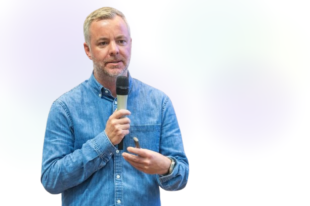

### Hey, I'm Stefan.

Managing Partner at [Frontira](https://frontira.com). We build intelligent systems that liberate intelligent people from unintelligent work.

Agentic Business Engineering, automation, AI. From strategy to production.

Based in Berlin and Salzburg.

---

A visible proof case is [Lobster Lager](https://www.lobsterlager.com/keynote): a brewmaster, an AI-assisted brewing workflow and a real beer. Jensen Huang showed the project in his NVIDIA GTC keynote; Peter Steinberger later mentioned it in his TED2026 talk. Its media record spans original reporting, interviews, podcasts and syndication. It is the story I use to make Agentic Business Engineering tangible.

**Public repos**

- [agent-awake](https://github.com/eranium21/agent-awake) - a tiny macOS menu bar app for keeping local agents and long-running jobs awake.
- [plaud-web-workflows](https://github.com/eranium21/plaud-web-workflows) - an unofficial Plaud Web CLI for batch renaming, searching, foldering, and exporting account-owned recordings.
- [cmuxws](https://github.com/eranium21/cmuxws) - a shell helper for creating cmux workspaces from repo features, routes, and navigation.
- [speaking](https://github.com/eranium21/speaking) - talks, panels, signature keynote topics, and appearances.
- [press](https://github.com/eranium21/press) - press, podcasts, TV, and media coverage.

Upcoming speaking includes the prerecorded [AI Coding Summit NYC 2026](https://gitnation.com/events/ai-coding-summit-nyc/talks) talk, [TourismFastForward 2026](https://www.tourismfastforward.com/speaker/stefan-erschwendner/) in Mayrhofen, and KIM 2027 in Salzburg.

Recent speaking includes the [DIH-West Forum](https://www.fh-salzburg.ac.at/fhs/aktuelles/veranstaltungen?cHash=09b58a975bd7e47b5772b6d54b5152b2&tx_news_pi1%5Baction%5D=detail&tx_news_pi1%5Bcontroller%5D=News&tx_news_pi1%5Bnews%5D=6468), a live interview at [LSZ CIO Kongress 2026](https://lsz.at/kongress/cio-kongress-loipersdorf), [Jobiqo Connect 2026](https://www.jobiqo.com/de/jobiqo-connect-2026/) and [AI Agents Summit 2026](https://ai-agents-summit.com/). See the [speaking archive](https://github.com/eranium21/speaking) for more.

Recent recognition includes [TokenMade Hamburg](https://tokenmade.ai) winner and three [AIR Salzburg 2026](https://www.meinbezirk.at/salzburg/c-regionauten-community/drei-auszeichnungen-fuer-das-projekt-der-salzburg-ag-zwei-fuer-das-projekt-der-oebb-infrastruktur-ag_a8605967) awards connected to Frontira work: Lobster Lager, Baumit Agent, and Salzwelten Smart Reply.

Recent Lobster Lager coverage includes [Salzburger Nachrichten](https://www.sn.at/wirtschaft/oesterreich/nach-erfolg-mit-ki-bier-will-ein-salzburger-senioren-begeistern-pensionisten-kann-man-nicht-durch-ki-ersetzen-art-679456)' interview with Gerhard about AI and older people. My recent interviews include [Business Punk](https://www.business-punk.com/agentic-business-engineering-der-naechste-schritt-von-openai/), [Die Presse](https://www.diepresse.com/41319730/ki-agenten-warum-trotz-aller-warnungen-niemand-bremst) and [Was KI kann](https://open.spotify.com/episode/0U9UdSZwwYMasst2D4RLcf). See the [press archive](https://github.com/eranium21/press) for original coverage, podcasts and third-party mentions.

Lobster Lager has also appeared in the [NVIDIA GTC Jensen Huang Keynote](https://www.nvidia.com/en-us/on-demand/session/gtc26-s81595/), [Peter Steinberger's TED Talk](https://www.ted.com/talks/peter_steinberger_how_i_created_openclaw_the_breakthrough_ai_agent), [BILD](https://www.bild.de/politik/inland/ein-helles-aus-dem-computer-bitte-vater-und-sohn-erfinden-ki-bier-69e5d950064e04c985e99d65), [NBC News](https://www.nbcnews.com/tech/tech-news/lobster-themed-event-ai-enthusiasts-exuberance-side-cocktail-sauce-rcna261892), [Business Insider](https://www.businessinsider.de/wirtschaft/oesterreicher-brauen-bier-mit-ki-agent-und-landen-in-keynote-vom-nvidia-chef/), [Business Punk](https://www.business-punk.com/tech/nvidia-chef-schmeckts-austria-ki-agenten-brauen-und-vermarkten-bier/), [Der Standard](https://www.derstandard.at/story/3000000315024/bier-brauen-openclaw-ki), [Die Presse](https://diepresse1848.podigee.io/1502-lobster), and [36Kr](https://eu.36kr.com/en/p/3720817143396993).
